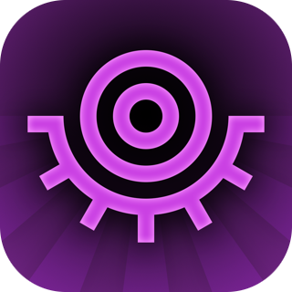
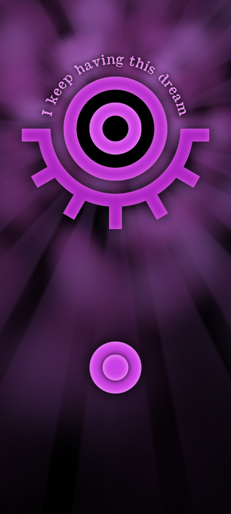
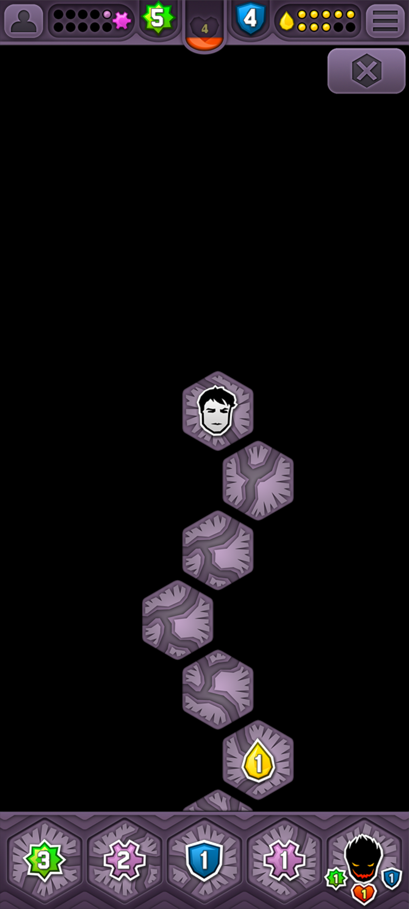
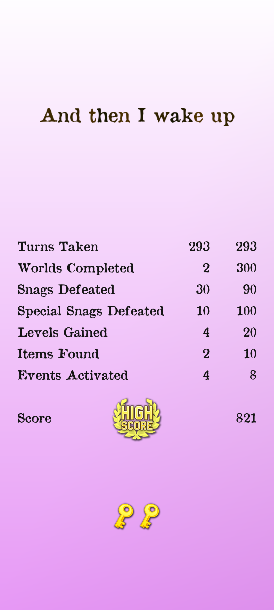
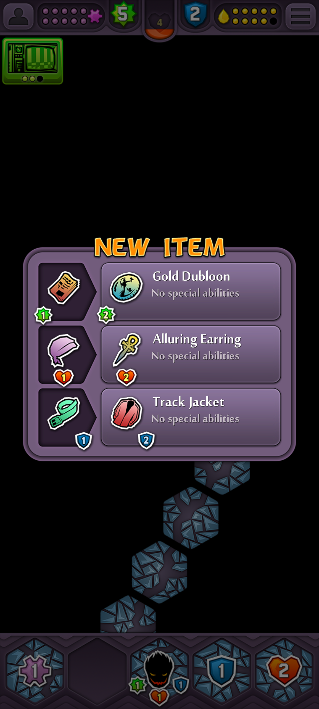
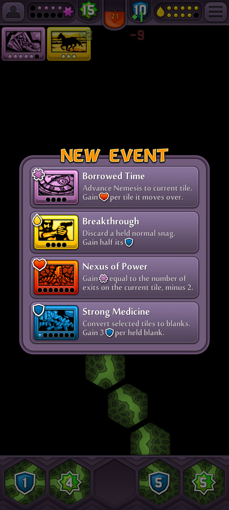
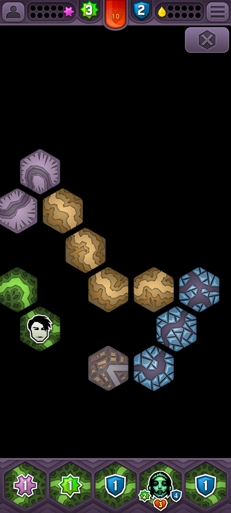

<div align="center">


# I Keep Having This Dream
[](https://f-droid.org/packages/com.fireflame.dream)
[](https://github.com/FuzionCD/dream-game-android/releases/latest)

#### **I Keep Having This Dream** is a strategy-roguelike game for Android.

<div align="left">

# Description

In this innovative puzzle RPG, build a path of tiles to escape each successive cycle of your dreamscape. A cycle gets more dangerous the longer you stay, so plan your route carefully, and make the most of the challenges and opportunities you meet along the way.

Place tiles to boost your attack and defence, defeat enemies to level up your character, and upgrade the right perks to stay safe as your ever-present enemies grow stronger. Take a detour off the direct pathway to discover items that may give you an edge, but watch out for the powerful special enemies that grow more frequent as you near the exit - if left untended, their powerful abilities will quickly spell your doom.

# Features

* 25+ upgradeable perks to augment and focus your strategy
* 150+ items to collect and boost your stats
* 100+ special enemies to encounter and overcome
* 80+ one-off events to choose from for a temporary boost
* Unlock more enemies, events, and cosmetics over several playthroughs

# Screenshots

<div align="center">
    <a href="meta/screenshots/carousel1.png"></a>
    <a href="meta/screenshots/carousel2.png"></a>
    <a href="meta/screenshots/carousel3.png"></a>
    <br>
    <a href="meta/screenshots/carousel4.png"></a>
    <a href="meta/screenshots/carousel5.png"></a>
    <a href="meta/screenshots/carousel6.png"></a>
    <br>
    <a href="meta/screenshots/carousel7.png"></a>
    <a href="meta/screenshots/carousel8.png"></a>
</div>

# Building from Source

IKHTD is written in C++ with a thin Java/SDL2 shell. The app builds for both `arm64-v8a` and `armeabi-v7a`, and supports Android 5.0 (API 21) and up.

## Requirements

| Component | Version |
| --- | --- |
| JDK | 21 (17 or newer works) |
| Android SDK Platform | android-35 |
| Android SDK Build-Tools | 36.0.0 |
| Android NDK | 27.2.12479018 (r27c LTS) |
| CMake | 3.22.1 or newer |

## Android Studio

Open the project, let it sync, and press Run. If prompted, install NDK `27.2.12479018` and CMake `3.22.1` from *Tools > SDK Manager > SDK Tools > Show Package Details*.

## Command line

```sh
./gradlew assembleRelease
```

The unsigned release APK is written to `app/build/outputs/apk/release/app-release-unsigned.apk`.

## Reproducible build (Docker)

Release builds are produced in a pinned Debian container that mirrors F-Droid's build environment. Because the source is mounted at a fixed path and all build paths are normalized (via the `-ffile-prefix-map` and `--build-id=none` flags in [app/src/main/jni/CMakeLists.txt](app/src/main/jni/CMakeLists.txt)), the output is byte-for-byte identical no matter which machine builds it. This is the build that is signed and published.

```sh
docker build -t dream-build .

docker run --rm \
  --user "root:root" \
  -v "$PWD":/project \
  -e HOME=/tmp \
  -e GRADLE_USER_HOME=/project/.gradle-docker \
  dream-build \
  ./gradlew --no-daemon clean assembleRelease
```

# Contributing

Contributions are welcome, whether it's a bug report, fix, device testing, or improvement to documentation.

* **Bugs and suggestions:** open an issue with a description of the problem, your device model and Android version, and the steps to reproduce it. If you're suggesting, give your reasoning for why you think your feature would improve the game.
* **Pull requests:** Currently, this project is *not* accepting PRs.

# Credits

This game is a full ground-up rewrite of the iOS app "I Keep Having This Dream" by Fireflame Games, which disappeared from the App Store sometime around 2018 and is no longer available anywhere. This was one of my favourite games to play and kill time with when I was younger, so when I wanted to play it a couple months ago I was shocked to see it had practically become unplayable lost media. I managed to find a copy of the game's assets (textures, sounds) from an old phone backup, and took on the project of rebuilding the entire game for Android using the given assets + the few screenshots and videos I was able to find online. This has been in the works for a long time, and I'm happy to share it with the open-source community.

* **Alex Kuptsov**, for the now-lost iOS original.
* **libsdl**, for SDL and SDL-mixer
* **kcat**, for OpenAL-soft
* Alex Arcoleo, James Bargent, Bob Bradley, Michael Bradley, Steve Dymond, Andreas Georgallis, Barrie Gledden, Joe Henson, Alex Kovacs, David O'Brien, Jason Pedder, Tom Quick, Adam Skinner, Dan Skinner, Tom Stubbs, Ben Ziapour: for the wonderful music used in this game
